# Finish the AI Dungeon Master (Gemini narrator, zero-compromise play)

**Status (2026-10-10):** Phase 0 **done**. Phases 1–9 not started.
Detail: [`SESSION_RECAP_2026-10-10_PHASE0.md`](SESSION_RECAP_2026-10-10_PHASE0.md).

| Phase | Status |
|-------|--------|
| 0 Dell bootstrap | **Done** |
| 1 Gemini narrator | Not started |
| 2 Intent sign-off | Not started |
| 3 Engine rest/roll/item/move | Not started |
| 4 Spell effects | Not started |
| 5 Persisted chat combat | Not started |
| 6 XP / scene / items | Not started |
| 7 Memory quality | Not started |
| 8 Cleanup | Not started |
| 9 Full playtest | Not started |

## Ground rules for the coding agents

- **Engine is authority.** The narrator never decides hit/damage/slots/HP/XP/conditions. Every mechanics action is classified → validated → resolved in `src/game_actions.py` → narrated from results. This is already true for attack/cast; extend it, never bypass it.
- **Local LLM path stays.** Add `DM_BACKEND=gemini|local` (default `gemini`). The Transformers code in [src/llm_manager.py](src/llm_manager.py) stays intact and selectable; do not delete or comment it out — gate it.
- **Fix intent misreads with data**, not keywords (README rule). Never raise `INTENT_MECHANICS_MARGIN`.
- **One phase = one branch/PR**, TDD, run the non-slow suite before merging, update `docs/` recaps.
- Mark a feature DONE only when the ASCII chat path enforces it without narrator invention (rule from `docs/ZERO_COMPROMISE_GAPS_2026-07-27.md`).

```mermaid
flowchart LR
  P0[Phase 0 Dell bootstrap] --> P1[Phase 1 Gemini backend]
  P1 --> P2[Phase 2 Intent P0 signoff]
  P2 --> P3[Phase 3 Engine rest roll item move]
  P3 --> P4[Phase 4 Spell effects]
  P4 --> P5[Phase 5 Persisted chat combat]
  P5 --> P6[Phase 6 XP scene items]
  P6 --> P7[Phase 7 Memory quality]
  P7 --> P8[Phase 8 Cleanup]
  P8 --> P9[Phase 9 Full playtest]
```

---

## Phase 0 — Dell bootstrap — **DONE** (2026-10-10)

Shipped on the Dell Inspiron 7405: Python 3.11 venv, tracked `src/config.py`, CPU/CUDA requirement split, user-space Postgres 17 (Docker unavailable), `rules.db` / `spells.db` loaded, playtest seeded, non-slow tests green except local-Mistral (skipped when `DM_BACKEND=gemini`).

Original blockers (for the record): no Python 3.11, no Postgres, no venv, and **`src/config.py` is gitignored** (`.gitignore:136`) so it never left the Alienware; every module does `from .config import settings`.

1. Install Python 3.11 (`winget install Python.Python.3.11`), create `llama_env_311`.
2. Create `requirements-cpu.txt` from `requirements_working.txt`: `torch==2.5.1` CPU wheel (`--index-url https://download.pytorch.org/whl/cpu`), `transformers==4.56.1`, `accelerate==1.10.1`; drop `bitsandbytes`, `torchvision`, `torchaudio`, `nvidia-ml-py`, `gpustat`; add `google-genai` (new SDK; `google-generativeai==0.3.2` is obsolete). Keep `requirements_working.txt` as `requirements-cuda.txt` for the Alienware. Torch/transformers are still needed for the MiniLM intent embedder on CPU.
3. **Recreate `src/config.py`** as a `pydantic-settings` `BaseSettings` reading `.env`, with every attribute the code references: `DATABASE_URL, DISCORD_TOKEN, BOT_CHANNEL_ID, OWNER_ID, GEMINI_API_KEY, XAI_API_KEY, LOCAL_MODEL_NAME, LOCAL_MODEL_PATH, LOCAL_LOAD_IN_4BIT, LOCAL_QUANTIZATION, MAX_MODEL_LEN, INTENT_*`, plus lowercase fields used by code: `custom_campaign_path` (`dnd_src_material/custom_campaigns`), `campaign_pdf_path`, `embedding_model`, `vector_store_dim`, `similarity_top_k`, `chunk_size`, `chunk_overlap`, `index_storage_path`. Add new `DM_BACKEND`, `GEMINI_MODEL`, `GEMINI_THINKING_BUDGET`, `GEMINI_MAX_OUTPUT_TOKENS`, `GEMINI_TIMEOUT_SEC`. **Remove `config.py` and `docs/` from `.gitignore`** (secrets live in `.env`, which stays ignored).
4. Postgres: Docker Desktop + `pgvector/pgvector:pg16` per `scripts/LOCAL_DB_SETUP.md`; `python scripts/reset_local_db.py --yes`.
5. Data: `python scripts/load_spells.py` (public 5e API), `python scripts/load_rules_from_md.py --fresh` (sources now present), `python scripts/seed_playtest.py --yes --reset --campaign the_sirens_embrace_a_pirates_odyssey`.
6. Verify: `pytest -m "not slow"` passes except tests that need a live model/Discord.

## Phase 1 — Gemini 3.5 Flash-Lite narrator (local path preserved)

Files: new `src/llm_backends/__init__.py`, `src/llm_backends/gemini_backend.py`; edit [src/llm_manager.py](src/llm_manager.py), [web/main.py](web/main.py) (startup lines 82–95, `/api/health`), `.env.example`, `README.md`.

- `GeminiBackend.generate(prompt, max_new_tokens) -> str` using `google.genai.Client(api_key=...)`, `models.generate_content(model="gemini-3.5-flash-lite", contents=prompt, config=GenerateContentConfig(temperature=0.8, max_output_tokens=..., thinking_config=ThinkingConfig(thinking_budget=0)))`. Tested today: ~1.7 s, 13/48 tokens, no thinking. Async via `client.aio`. Timeout 30 s, 2 retries with backoff on 429/5xx, log `prompt_tokens / output_tokens / ms / est_usd` per call (prices: $0.30/M in, $2.50/M out).
- `LLMManager.generate()`: dispatch on `settings.DM_BACKEND`. `gemini` → backend; `local` → existing `_generate_local` unchanged. Move `import torch` / `transformers` imports inside `load_model` / `_generate_local` so Gemini mode starts without CUDA libs. `load_model()` becomes a no-op in Gemini mode; `_MAX_NEW_TOKENS_CAP=180` applies to local only (Gemini cap 400 for narration, 800 for session summaries).
- Keep the text `TOOL_CALL` protocol as-is so [src/tool_executor.py](src/tool_executor.py) needs no changes. (Native Gemini function calling is optional later.)
- `web/main.py` startup: only preload when `DM_BACKEND=local`. `/api/health` returns `{"backend": ..., "model": ...}`.
- Also migrate [src/campaign_generation/stage_managers.py](src/campaign_generation/stage_managers.py) lines 110–113 from `genai.configure(...)`/`gemini-1.5-flash` (retired) to `google-genai` + `gemini-3.5-flash-lite`.
- Tests: `tests/test_llm_backend_gemini.py` with a fake client (no network); existing tests pass with `DM_BACKEND=local` monkeypatched where they rely on local behaviour.
- Done when: `/playtest` → `hello` returns narration in under 5 s on the Dell; cost logged.

## Phase 2 — Intent P0 sign-off (`docs/SESSION_RECAP_2026-07-27.md` "Still open")

Files: [src/dynamic_dm.py](src/dynamic_dm.py) (`_get_active_weapon_names` ~601, pass to `run_tool_loop`), [src/tool_executor.py](src/tool_executor.py) 374–378, [src/player_intent.py](src/player_intent.py), `tests/data/intent_eval.jsonl`, `data/intent/examples.jsonl`.

- Plumb `spell_names` (known+prepared from `spell_integration.get_character_spells`) and `npc_names` into `parse_player_intent` from production, so cast "slot resolved" means "in spellbook".
- Add a named-NPC attack row (`i attack Mira`) and 5+ more rows per thin class to the eval set; grow `repeat_last` (8 examples), `rest` (17), `move` (18) training data.
- Run the 9-line live smoke after a clean restart: `/playtest` → `/session start` → `hello` / apology / `i attack the table` / `i attack the table again` / `try again` / `i attack Mira`. Run from the browser only (one `user_id`).
- Done when: smoke green, `scripts/eval_intent.py` shows 0 speech→mechanics leaks, slow gates pass.

## Phase 3 — Engine-owned rest, roll, use_item, move (P0.2)

Today `resolve_intent` ([src/intent_resolver.py](src/intent_resolver.py) 234–240) returns `handled=False` for everything but attack/cast, and `fill()` ([src/intent_slots.py](src/intent_slots.py) 134–149) no-ops for other actions.

- `PlayerIntent` ([src/player_intent.py](src/player_intent.py) 54–66): add `rest_type`, `roll_kind` (`skill|ability|save|initiative|death`), `roll_name`, `item_name`, `destination`.
- `intent_slots.fill`: `_fill_rest` (short/long, default ask), `_fill_roll` (closed set of 18 skills + 6 abilities + saves), `_fill_use_item` (closed set = character inventory names passed like `weapon_names`), `_fill_move` (closed set = known locations from world state + the campaign markdown headings; unresolved → clarify). Extend the margin+slots gate in `parse_player_intent` (432–449) to all mechanics actions.
- `game_actions.py` new methods, each returning a mechanics dict:
  - `resolve_rest(character_id, rest_type)`: short rest spends hit dice using `CharacterHitDice` (currently unimplemented in `spell_integration.character_rest` 540–591), long rest full HP/slots/half hit dice, clear conditions that end on rest, Warlock slot rule kept.
  - `resolve_check(character_id, kind, name, dc=None, advantage=...)`: real modifiers via `character_manager.calculate_skill_modifier` / `calculate_saving_throw_modifier` (today `roll_dice_for_character` ignores `character_id`). DC comes from DM tool arg or defaults to "report total, DM narrates".
  - `use_item(character_id, item_name)`: consumable table (Potion of Healing 2d4+2, Greater 4d4+4, etc.) in `rules_db`/`equipment_system` → `modify_hp` + `update_inventory(qty-1)`; non-consumables → equip or "no mechanical effect" result.
  - `move_to(location)`: `set_location` + switch scene-object location + flag `left_melee` for Phase 5 OA.
- `resolve_intent`: branches for the four actions; `run_tool_loop` narrates from `outcome.reply` only (same pattern as cast narration, 484–509).
- `dynamic_dm._generate_contextual_response`: fetch inventory names, spell names, known locations and pass through `run_tool_loop`.
- Tests: `tests/test_intent_slots.py`, `tests/test_intent_resolver_actions.py` (new), engine tests for rest/check/use_item with DB skip-if-unavailable.
- Done when: "I take a short rest", "I roll Insight on the mayor", "I drink a healing potion", "I walk upstairs" all change DB state with no TOOL_CALL from the narrator.

## Phase 4 — Spell effects and concentration (P1.1)

Today a chat cast only consumes a slot (`_resolve_cast` 131–190, `_backend_cast_tools`). `EnhancedSpell` already exposes `damage.damage_at_slot_level`, `saving_throw.ability/success_type`, `attack_type`, `concentration`, `heal_at_slot_level`.

- `game_actions.resolve_spell_cast(character_id, spell_name, target_name=None, slot_level=None)`: legality (`_validate_spell_cast`) → cantrip or slot consume → if `attack_type`: spell attack (spellcasting mod + prof) vs target AC → if `saving_throw`: DC 8+prof+mod, target rolls using catalog ability scores (monsters) or `calculate_saving_throw_modifier` (PCs/NPCs), half on `success_type=="half"` → roll damage dice at slot level (cantrip scaling by character level) → apply to combatant / NPC row / scene object → healing → `modify_hp` → concentration → set `concentration_spell` on combatant and new `Character.concentration_spell` column (Alembic `002`). Class→spellcasting-ability map in `spell_integration`.
- Cast slots: extend `_fill_cast` with optional `target`; untargeted damage spells ask "at whom?" via `pending_clarify`.
- Concentration checks: fix `Combatant.make_concentration_save` (combat_system 163–190) to use real CON mod + proficiency and trigger on every damaging hit while concentrating, not only at 0 HP.
- Tests: fire bolt hit/miss, fireball save half, cure wounds heal, concentration break.
- Done when: "I cast fire bolt at the goblin" reduces goblin HP or misses with a logged roll; Fighter casting Fireball is refused.

## Phase 5 — Chat-driven, persisted combat with monster turns (P1.2)

Today: encounters are in-memory (`CombatManager.active_encounters`), no per-campaign pointer, no monster AI, no action economy, out-of-combat NPC attacks roll vs hardcoded AC 12 and damage nothing (`resolve_player_attack` 651–730).

- **Persistence:** Alembic `003`: table `combat_encounters(id PK text, campaign_id FK unique-active, name, is_active, round, turn, initiative_order JSONB, combatants JSONB, started_at, updated_at)`. `CombatEncounter`/`Combatant` get `to_dict/from_dict`; `CombatManager` saves after every mutation and loads the active encounter for the campaign on `load_campaign`. Add `campaign_state_manager.active_encounter_id`.
- **Start from chat:** attacking an NPC/monster when no encounter is active → create encounter, add PC (+ active companion from `animal_companion_manager`), add the target (and any `hostiles` the DM registered via a new `add_hostile_to_scene` tool) with catalog stats, roll initiative, then resolve the attack as the PC's action. Replace the AC-12 path.
- **Action economy:** per-combatant per-turn `action_used, bonus_used, reaction_used, movement_left`; attack/cast consume the action; second attack refused with a clear message; "I end my turn"/"done" or action spent → auto-advance.
- **Monster turns:** `run_hostile_turns(encounter)` runs after the PC's turn ends until the next PC/companion: target = lowest-HP conscious PC/companion, `resolve_attack`, multiattack from catalog `actions` if present, mark engagement; return mechanics lines; one Gemini narration covers the whole round.
- **Death saves:** PC at 0 HP at turn start → `character_manager.roll_death_save` automatically; stable/dead handling; monsters die at 0 and are removed from initiative.
- **Opportunity attacks:** zone model, not a grid: `engaged_with` set per combatant (melee attack marks it); `move_to` out of engagement with hostile `reaction_used=False` → OA.
- **End:** all hostiles dead/fled → `end_combat`, HP sync, XP award (Phase 6), delete/flag encounter row. ASCII `/combat` status frame in `src/ascii_ui/render_status.py`.
- Tests: `tests/test_combat.py` extended: persistence round-trip, monster turn, action economy refusal, death save, OA.
- Done when: a two-goblin fight starts from "I attack the goblin", goblins act on their turns without the narrator, the server can be restarted mid-fight and resume, and the fight ends with XP.

## Phase 6 — XP, scene registry, items (P2)

- **XP:** SRD CR→XP table in `rules_db` (`monsters.xp` column, loader update) with `monster_catalog` fallback; `game_actions.award_xp(character_id, amount, reason)` writes `CharacterProgression.experience_points`, sets `level_up_pending`; called from combat end and a DM `award_xp` tool for milestones. Level-up offered in chat; `/levelup` applies via the logic in `enhanced_character_api` (reuse, don't duplicate). Fix the missing `Character.progression` relationship.
- **Scene registry:** persist `scene_object_store` as `campaign_world_state.scene_objects JSONB` keyed by location (Alembic `004`); DM tool `register_scene_object(name, ac, hp, material)`; `target_resolve.resolve_attack_target` returns `unknown` → clarify instead of defaulting any noun to `object` ([src/target_resolve.py](src/target_resolve.py)).
- **NPC HP:** out-of-combat damage to an NPC updates `npcs.current_hp`.
- **Consumables:** expand the table (potions, scrolls, rations); `/use <item>` slash alias.

## Phase 7 — Memory quality and grounding (P3.1)

- Structured recap: Alembic `005` adds `session_summaries.structured JSONB`; at session end Gemini produces JSON via `response_schema` (`location, npcs_met[{name,trust_delta}], threads_opened/closed, combat[], loot[], xp, cliffhanger`) plus the prose. "Last time on…" built from structured fields. Both `web/main.py` 284–314 and `src/ascii_ui/commands.py` `/session` share one `summarize_session()` helper.
- Grounding: `_build_massive_context` ([src/dynamic_dm.py](src/dynamic_dm.py) 657–700) puts `CURRENT LOCATION`, scene objects, present NPCs and active encounter first. Raise budgets for Gemini (history 10×600 chars, campaign excerpt 6000, summaries last 5); ~6–8k tokens per turn ≈ $0.002.
- Fix `state_dataclass_to_row_fields` wiping `plot_flags` ([src/world_state_store.py](src/world_state_store.py) L56).
- Done when: "where am I?" answers from world state, and a restart + `/session start` recaps the real last session.

## Phase 8 — Cleanup (P3.2 and hygiene)

- Delete dead modules: `src/bot.py`, `start_system.py`, `detailed_campaign_generator.py`, `analyze_structures.py`, `additional_class_features.py`, `character_calculator.py`, `llm_manager_dialogpt_test.py`, `setup_indexes.py`, `sync_campaigns.py`, `spell_system.py` (after confirming `level_progression` can use `enhanced_spell_system`), `tests/test_discord_connection.py`, `tests/test_send_message.py`, `web/frontend_legacy/`, dead `VLLM_*` config.
- Collapse intent layers in `run_tool_loop`: one classification per turn; drop `classify_player_intent` tier logic and the AUTO backend safety nets (604–645) once Phases 3–5 make `resolve_intent` own all mechanics; keep `prose_claims_mechanics`, `pending_clarify`, `last_attack`. Remove `INTENT_BACKEND=llm` and `intent_llm.py` (keep eval script embed-only). Fix stale "IntentLLM primary" comments.
- Campaign layer: write the ownership map (generator creates files, `campaign_manager` registers, `campaign_state_manager` tracks play state); delete `campaign_manager` paths unused by the web app.
- Move `last_attack`/`pending_clarify` dicts to `campaign_world_state` or a small table so clarifications survive restart.
- Split `requirements.txt` into base + `-cpu` + `-cuda`; README updated for Gemini-first setup.

## Phase 9 — Definition of done: full playtest script

Run on the Dell with `DM_BACKEND=gemini`, then once on the Alienware with `DM_BACKEND=local` to prove the switch still works:

1. `python scripts/reset_local_db.py --yes` → seed → `/playtest` → `/session start`.
2. Talk to Mira (speak, no dice). "I roll Insight on Mira" (engine check).
3. "I walk to the docks" (location changes). "I attack the goblin" → encounter starts, goblins act, PC drops to 0 → auto death save → healed by companion/potion.
4. "I cast fire bolt at the goblin" (HP drops), "I drink a healing potion", kill both → XP awarded, level-up offered.
5. "I take a short rest" (hit dice spent). `/session end` → structured recap.
6. Restart server → `/session start` → correct "Last time on…"; `/sheet` shows persisted HP/XP/inventory.
7. Cost check: whole session logged under ~$0.05.

## Costs and risks

- Gemini Flash-Lite at ~3k prompt / 200 output tokens per turn ≈ $0.001; a 200-turn session ≈ $0.20–0.40 with the larger Phase 7 context.
- Key is in this chat's transcript; regenerate in AI Studio when convenient and set a billing alert.
- Phase 5 is the largest; split into 5a persistence, 5b start-from-chat + action economy, 5c monster turns + death saves, 5d OA + end/XP if one PR gets too big.
- `src/config.py` recreation must match attribute names exactly; grep list above is the contract.